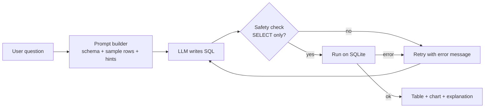

# Natural-Language Data Analysis Agent (Text-to-SQL)

Ask questions about a database in plain English. An LLM-based agent writes the SQL, checks that it is safe,
runs it, and shows the result as a table, a chart and a short explanation.

**Live demo:** _paste your Streamlit link here_

> Minor Project (23CSA391A), Amrita Vishwa Vidyapeetham (AHEAD Online)  
> Author: Shivraj Parmeshwar Amale

## Screenshots
_Add 2-3 screenshots here (for example `docs/screenshot1.png`) and link them with ``._

## Features
- Plain-English questions -> SQLite queries (Text-to-SQL) using an LLM
- **Safety check:** only a single read-only `SELECT` is executed (INSERT / UPDATE / DELETE / DROP are blocked)
- **Self-correction:** if a query fails, the error is sent back to the LLM, which retries (up to 2 times)
- Shows the generated SQL, a results table, an automatic bar chart and a plain-English explanation
- Use the built-in sample shop database or **upload your own CSV files**
- 4 prompt strategies to compare: question only, schema, schema + sample rows, schema + sample rows + examples
- Evaluation script with a 32-question test set (easy / medium / hard)

## Architecture


## Results
Execution accuracy on the 32-question test set (sample shop database). _Fill in after running `python eval.py`._

| Setting | Accuracy | Easy | Medium | Hard |
|---|---|---|---|---|
| Question only (no schema) | | | | |
| Schema | | | | |
| Schema + sample rows | | | | |
| Schema + sample rows + examples | | | | |
| Full system + self-correction | | | | |

## Setup
```bash
python -m venv venv
venv\Scripts\activate            # Windows  (Mac/Linux: source venv/bin/activate)
pip install -r requirements.txt
set ANTHROPIC_API_KEY=your_key   # Windows  (Mac/Linux: export ANTHROPIC_API_KEY=your_key)
streamlit run app.py
```
Without an API key you can still explore the data with the "Run SQL manually" box.

## Free hosted option: Gemini API (works online too)
1. Get a free key from Google AI Studio (aistudio.google.com) and set `GEMINI_API_KEY`
   (Windows: `set GEMINI_API_KEY=your_key`).
2. Choose **Gemini API** in the sidebar. If the model name stops working, set `GEMINI_MODEL` to a current name from AI Studio.
3. Free-tier limits and data-use terms change: do not send private data, and check the limits in AI Studio.

## Free option: local model with Ollama (no API key, no cost)
1. Install Ollama from https://ollama.com and keep it running.
2. In a terminal run: `ollama pull qwen2.5-coder:3b` (about 2 GB; use `qwen2.5-coder:7b` if you have 16 GB RAM).
3. Run `streamlit run app.py` and choose **Free local model (Ollama)** in the sidebar.
Small local models are slower and less accurate than Claude; comparing both is a good point for the report.
(Ollama works only on your own computer, not on Streamlit Cloud.)

## Run the evaluation
```bash
python eval.py
```

## Project structure
| File | Purpose |
|---|---|
| `app.py` | Streamlit web interface |
| `agent.py` | Database loading, prompts, safety check, LLM calls, agent loop with self-correction |
| `test_set.py` | Test questions with correct SQL |
| `eval.py` | Execution-accuracy evaluation for different settings |

## Deployment (Streamlit Community Cloud)
1. Push this folder to a GitHub repository (do **not** upload your API key).
2. On share.streamlit.io choose **New app**, select the repo, and set the main file to `app.py`.
3. Under **Advanced settings -> Secrets** add `GEMINI_API_KEY` (see `secrets.toml.example`).
4. In the deployed app choose **Gemini API** in the sidebar (Ollama works only on your own computer).

## Limitations
- Works on SQLite only; very large or very complex schemas may reduce accuracy.
- The LLM can still write wrong SQL; always check the generated query.
- Uploaded CSV data lives only in memory for the current session.

## Future work
- Support more databases (MySQL / PostgreSQL), multilingual questions (Hindi), conversation memory for follow-up questions, and more chart types.